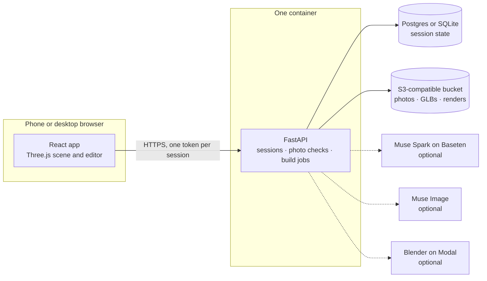

<p align="center">
  
</p>

<h1 align="center">roomset</h1>

<p align="center">
  <b>Make room for what fits.</b><br/>
  Put the exact piece of furniture you are considering into your space, in 3D and AR.<br/>
  Real dimensions, moved by hand, in the browser on your phone.
</p>

<p align="center">
  <a href="docs/TESTING.md"><b>Try it</b></a> ·
  <a href="#quick-start"><b>Quick start</b></a> ·
  <a href="#what-you-can-do"><b>What you can do</b></a> ·
  <a href="#architecture"><b>Architecture</b></a> ·
  <a href="docs/STATUS.md"><b>What works today</b></a>
</p>

<p align="center">
  <sub>Built for the Meta Global AI Developer Hackathon</sub>
</p>

---

## Why Roomset

A listing tells you a sofa is 210 cm wide. It does not tell you whether that leaves room to walk past the radiator. Most people find out on delivery day.

| | |
|---|---|
| **62%** | of furniture shoppers find it hard to picture how a piece will look at home [1] |
| **60%** | say they have bought furniture online that turned out to be the wrong size [2] |
| **19–23%** | is the reported return rate for furniture bought online [3] |

Other tools sell their own catalog, or generate a new picture of your room. Roomset starts with the piece you chose, keeps its measurements, and gives you geometry you can move.

## What you can do

For the Windows phone demo, run `scripts/phone.cmd` and open its `/demo` link. See the
[demo walkthrough](docs/DEMO_GUIDE.md) for the presentation script, your-own-room flow,
and the verified boundary between measured rooms and experimental photo reconstruction.

| | |
|---|---|
| **Walk through a sample apartment** | Three furnished rooms in 3D, built from real 360° photographs. No sign-up and no setup. |
| **Move anything** | Drag, turn, add, remove and reset furniture. Each drag runs in your browser, with no model call. |
| **See the numbers** | Tap a piece for its size, floor share, nearest wall and clear space in front. |
| **Get a layout review** | Built-in checks flag tight routes, seating distances and bed access, measured from your layout. |
| **See if it fits** | A 250 cm sofa against a 240 cm wall, then a 210 cm option in the same room. A one-minute demo with no setup. |
| **Stand it on your real floor** | Open any piece, or a whole furnished room, in AR on an iPhone at its true size. |
| **Ask out loud** | Point the camera at a space and ask in English or Vietnamese. Roomset answers, reads it aloud and suggests pieces. It does not measure your room. |
| **Plan your own room** | Sofas first, more types to come. Confirm the size, add photos, answer a few questions, then drag a true-size sofa and save the layout. |
| **Use it on your phone** | Touch gestures, swipeable sheets and home screen install. The sample apartment also opens offline after one visit. |

<table>
  <tr>
    <td width="50%"></td>
    <td width="50%"></td>
  </tr>
  <tr>
    <td align="center"><sub>The whole apartment</sub></td>
    <td align="center"><sub>Inside a room</sub></td>
  </tr>
  <tr>
    <td width="50%"></td>
    <td width="50%"></td>
  </tr>
  <tr>
    <td align="center"><sub>The top-down plan</sub></td>
    <td align="center"><sub>Your sofa, at its confirmed size</sub></td>
  </tr>
</table>

<p align="center">
  
</p>

## How it works

1. **Confirm the piece.** Paste a listing link or type the size. Nothing is used until you confirm it, and a missing value stays missing.
2. **Show the space.** Add 3 to 6 photos. Roomset checks them for blur, darkness and duplicates.
3. **Answer a few questions.** Wall lengths, whether you used a tape, and anything fixed in the way.
4. **Move it in 3D.** Roomset builds your room and sofa as geometry. Drag and rotate, read the clearances, and save the layout.

## What is real today

Roomset says what it knows and what it does not. The app labels every room by how it was made, and estimates stay marked as estimates.

| Status | What |
|---|---|
| **Working, no keys needed** | Landing page, fit demo, sample apartment, AR on iPhone, planner, saved layouts, rule-based review, phone layouts |
| **Working with your keys, run live** | Muse Spark reading and AI architect, Muse Image style previews, voice assistant in Vietnamese and English |
| **Built, not yet proven on the real service** | Photo corner draft with VGGT on Modal (off by default), Blender on Modal, Android AR |
| **Not built yet** | Fully automatic room reconstruction, SAM segmentation |

Three limits worth knowing:

- Your photos are checked, but they do not shape the room yet. Your measurements do, and the app labels those rooms as assisted.
- The sample apartment is one real room photographed in three finishes, placed on a made-up plan. Its sizes are close estimates.
- AR has been opened on a real iPhone. Android AR and most touch behavior have only been tested in simulation.

The full record is in [docs/STATUS.md](docs/STATUS.md).

## Architecture



Two rules hold the design together:

- **Size and fit come only from geometry.** Models interpret and suggest. They do not measure, and their output is never run as code.
- **Moving furniture stays in the browser.** A drag never calls a model or rebuilds the scene.

| Layer | Stack |
|---|---|
| Frontend | React 18, TypeScript, Vite, Three.js, Motion |
| Backend | FastAPI, SQLAlchemy 2, Alembic, trimesh |
| Storage | SQLite or Postgres, local disk or S3-compatible storage |
| AI | Muse Spark on Baseten, Muse Image |
| Hosting | Docker on Render with Supabase, or a static preview on Vercel |

## Quick start

You need Python 3.11, Node 22+, [uv](https://docs.astral.sh/uv/) and make. Windows setup is in [docs/DEMO_GUIDE.md](docs/DEMO_GUIDE.md). What to try, and what to expect, is in [docs/TESTING.md](docs/TESTING.md).

```bash
cp .env.example .env     # Provider keys are optional
make setup
make dev                 # http://localhost:5173
```

Everything under "Working, no keys needed" runs at this point. To turn on the AI features, add keys to `.env`:

| Key | Turns on |
|---|---|
| `BASETEN_API` | AI listing and screenshot reading, and the AI architect |
| `MUSE_API` | Style previews |
| `ASSEMBLYAI_API` | With `BASETEN_API`, the voice assistant on `/ar` |

| Command | What it does |
|---|---|
| `make dev` | Backend on :8000 and frontend on :5173 |
| `make test` | Backend and frontend tests |
| `make lint` | Ruff and TypeScript checks |
| `make build` | Production frontend bundle |
| `make image` | Single-container Docker image |
| `make phone` | Build, start on :8000 and print an ngrok link for testing on a phone |
| `make stop` | Stop everything the project started, including `make dev` and ngrok |

## Privacy

Photos are re-encoded to remove location data and stored privately. Each session can read only its own data. Sessions and files are deleted after 7 days by default, or at once when you delete your plan.

## Documentation

- [Architecture](docs/ARCHITECTURE.md): how the system fits together and what every folder holds
- [Deploying](docs/DEPLOY.md): a quick Vercel preview, and the full app on free tiers
- [Testing](docs/TESTING.md): what to try on the hosted preview and locally
- [Demo guide](docs/DEMO_GUIDE.md): running and presenting the demo
- [Status](docs/STATUS.md): verified and unverified behavior, and the remaining work
- [Project plan](https://github.com/khanhtuongnakitomo/RoomSet/issues/2): product scope and contracts

## Team

| | |
|---|---|
| **Long Quan Ton** ([GitHub](https://github.com/BennedictQuanTon), [LinkedIn](https://linkedin.com/in/bennedictquanton)) | AI and 3D engineering: photo analysis, geometry and the 3D studio |
| **Khanh Tuong Huynh** ([GitHub](https://github.com/khanhtuongnakitomo)) | Software engineering: product flow, backend, hosting and submission |

## References

1. [3D Cloud / Provoke Insights survey, Furniture Today](https://www.furnituretoday.com/technology/3d-cloud-release-study-linking-3d-visualization-and-customer-satisfaction)
2. [Interiors Monthly](https://interiorsmonthly.co.uk/shoppers-expect-furniture-stores-to-pay-for-buy-try-return/)
3. [Eightx 2025 benchmark](https://eightx.co/blog/average-furniture-and-home-return-rate-benchmarks)

3D models, panoramas and photographs are CC0. Sources are listed in [frontend/public/landing/CREDITS.md](frontend/public/landing/CREDITS.md).
