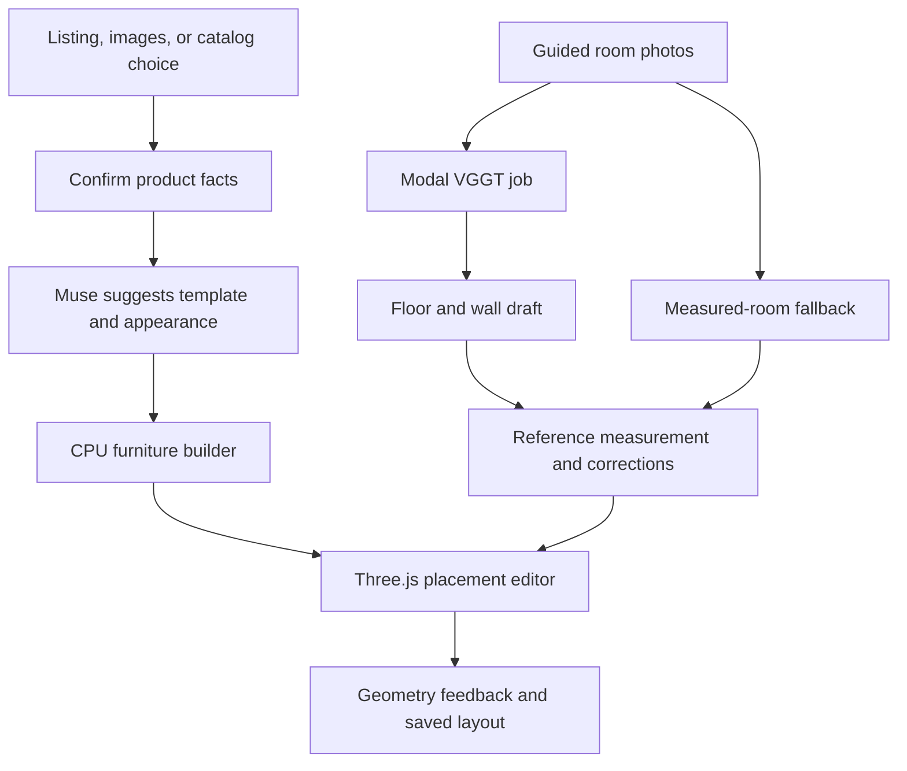

# Roomset: from a furniture listing to a decision in your own space

Detailed product and implementation proposal · 3 November 2026 · UTC+7

Prepared for Tường and Benedict. Based on merged commit `08acaa2a8fbe037134b2d094f0273767a503f318`, the existing proposal and issues #2–#4, and the product discussion in this chat. This document proposes the next implementation; it does not report those features as completed or authorize deployment, spending, commits, or publication.

Reading guide: sections 1–4 explain the product; sections 5–7 explain how furniture, room geometry and fit work; sections 8–12 are the engineering handoff; sections 13–14 describe the demo and first deliverable.

## 1. The experience we are building

**Roomset helps someone bring a particular sofa into a model of their own room corner, try arrangements, and understand what the sofa would obstruct before buying it.**

The important moment is seeing a recognizable approximation of the chosen product, at its confirmed size, in a space derived from the person's own inputs. Moving it should reveal a useful consequence: it crosses the captured boundary, overlaps a radiator, or leaves more clearance in another position.

Illustrative story, not an existing test result:

> Linh finds a green sofa online. She pastes the listing, confirms its size, and sees a similar 3D sofa. She takes four overlapping photos of the corner beside her window and marks a measured wall segment. Roomset proposes the corner's boundaries. She corrects the radiator position, then tries the sofa. A 250 cm option exceeds the confirmed 240 cm usable wall length by 10 cm. She selects a genuine 210 cm product variant, confirms its depth and height too, and tries a new arrangement. The app shows 30 cm of total remaining length along that wall and separately checks the surrounding obstacles. She saves the layout and returns to the listing.

The 30 cm figure is not a claim about a walking route. Every message must describe the actual distance or overlap computed. Missing or uncertain room geometry must not become a positive fit verdict.

### What improves on the previous plan

| Earlier plan or current behavior | This proposed implementation |
|---|---|
| Broad photo-to-3D ambition | A supported corner, a concrete capture procedure, scale confirmation, and a correction screen |
| One sample sofa stretched to size | Two adjustable straight-sofa templates, selected from product evidence and confirmed by the user |
| Product appearance kept as free text | A small validated description of template, cushions, arms, legs, color, and material |
| Photos followed by a room-dimension form | Attempt real reconstruction on Modal; present its proposed geometry for confirmation; retain an explicit measured-room fallback |
| Nearest-distance and overlap feedback | Clear distinctions between overlap, proximity, outside-captured-area, and insufficient evidence |
| Separate planner and catalog AR experiences | One core planner journey first; AR for the same custom asset only after export and device verification |
| November 2–3 milestones written before the app existed | Incremental work from the merged application, with revised gates and a protected demo window |

## 2. What exists, and what the evidence actually establishes

The following is based on source inspection. Existing code is not automatically a verified hosted integration.

| Area | Current observation | Action |
|---|---|---|
| Intake | Listing parsing, screenshot interpretation, manual confirmation, unit conversion and guarded retrieval exist | Extend and validate against selected real listings |
| Furniture | Default builder rescales one photoscanned sofa; a separate Blender builder produces a simple block sofa | Add controlled template variation and appearance review |
| Photo capture | Uploads, orientation/metadata handling, blur/darkness/duplicate checks exist | Add guided viewpoints and genuine geometry checks |
| Photo interpretation | Baseten can suggest same-area judgments and questions | Map useful answers into actual boundary/obstacle corrections |
| Room building | The pipeline builds from entered wall lengths and obstacles | Introduce a photo-derived draft without breaking the current path |
| Reconstruction | `worker/modal_app.py:reconstruct_corner` raises `NotImplementedError` | Implement and test on Modal; do not count deployment of the existing worker as reconstruction |
| Editor | GLB loading, movement, rotation, top view, overlap/distance calculations and save routes exist | Extend feedback and connect product/room revisions |
| AR | Catalog GLB/USDZ links exist | Custom session furniture export and private access remain separate work |
| Hosting | Docker, Vercel and Render configuration exist | Connect and test actual services; Render configuration currently points at `test` |
| CI | Main's November 3 run has 67 backend tests passing and one assistant warm-up test failing | Diagnose and fix before release; do not suppress the test to obtain green CI |

The current app is a substantial starting point. The primary missing capability is reliable photo-derived room geometry. A secondary gap is preserving and using product-specific appearance information.

Current CI evidence: [main run 41637825249](https://github.com/khanhtuongnakitomo/RoomSet/actions/runs/41637825249). The failing test is `test_warm_returns_at_once_and_only_once_a_minute`; this plan makes no root-cause claim.

## 3. Decisions and boundaries

The user's established direction is a listing/image/manual input flow, dimensioned furniture, photographs of a placement area, and an interactive result. AI services stay within **Meta/Muse, Baseten, and Modal**. No fal, Replicate, or additional inference provider is proposed.

The following are implementation recommendations for review, not previously approved product specifications:

- **Furniture:** straight sofas first; two templates: a low plinth-base sofa and a raised-leg sofa. Cushion count, arm proportions, color and a few material presets are adjustable. Sectionals, recliners and arbitrary furniture are deferred.
- **Room:** one approximately rectangular placement corner with two visible walls and a floor region. No full-home scan, hidden-space reconstruction, or concave room editor in this delivery.
- **Capture:** start with four guided photos; allow three to six. Request a replacement or an additional view when necessary. This is a supported capture workflow, not a promise that every four-photo set reconstructs.
- **Scale:** require a measured reference for dimension-based advice. Offer estimated visualization without implying reliable physical fit.
- **Appearance:** a recognizable approximation, clearly identified as such. Exact upholstery patterns, unseen surfaces and product replicas are outside the first release.
- **Interaction:** one active sofa per layout, drag/rotate/reset/top view/save. A different size is a different confirmed product variant, not a scaling gesture on the selected product.
- **AR:** optional after the browser flow passes; the existing catalog AR is not proof that custom generated furniture works in AR.
- **Hosting:** Vercel + Render + Supabase remain the proposed application infrastructure. The three-provider restriction applies to AI inference/compute; this interpretation follows the preceding hosting discussion.
- **Existing extras:** preserve the studio and existing voice feature, but do not expand them or require a new voice-provider dependency for this core flow.

## 4. The screens, in the order a person experiences them

| Screen | What the person sees and does | What the system must do |
|---|---|---|
| 1. Bring your sofa | Paste a link, upload product images/screenshot, enter details, or choose a verified sample sofa | Retain source material privately; extract facts; distinguish catalog examples from real listings |
| 2. Confirm the product | Name, product image, width/depth/height with units and source; missing fields highlighted | Require confirmation; preserve original extraction and subsequent edits |
| 3. Check the 3D approximation | Product photo beside a rotatable sofa preview; choose closest shape, color and material | Suggest a supported template; build correct outer dimensions; label inferred details |
| 4. Photograph the corner | Four viewpoint prompts with thumbnails and retake guidance | Check image quality; retain consistent orientation; prepare reconstruction after explicit session activity |
| 5. Confirm your space | Proposed floor/two-wall outline, source photo, reference endpoints, known distance, obstacles | Calibrate scale; show unsupported regions; accept bounded corrections; use measured fallback if needed |
| 6. Try an arrangement | Large 3D view; product size; move/rotate/reset/top view; one useful placement message | Calculate from geometry locally; do not call AI or rebuild assets on drag |
| 7. Save or compare | Save layout, return to listing, or choose a confirmed alternative | Restore product, geometry and placement after reload; keep room reconstruction when changing furniture |

Use the existing Warm Habitat styling and mobile sheets. User-facing labels should describe the result: “Product size confirmed,” “Shape approximated,” “Room boundaries confirmed,” or “Some areas are unknown.” Provider names and model identifiers belong in technical evidence, not the main task flow.

The measured fallback must say “Built from your measurements.” A photo-derived, corrected room can say “Built from your photos and confirmed measurements.” A saved example must say “Previously processed example.”

## 5. How the furniture model is created

### 5.1 Extract facts, then interpret appearance

Reuse product intake for listing text and metadata. Add a protected product-image upload path; the current screenshot reader returns a draft but does not retain that screenshot as a durable reference asset.

Baseten Muse Spark receives the useful listing content and selected product images. It returns a validated description, not executable code:

- Supported template identifier and suggested cushion count.
- Arm style, visible legs/base style, approximate base color and material preset.
- Dimensions explicitly stated in the source, with missing values left missing.
- Uncertain details and a short explanation when no template is a good match.

The user confirms dimensions separately from appearance. Never infer centimeters from an isolated product photograph and silently treat them as listing facts. If width/depth ordering is ambiguous, ask rather than trust an unlabeled dimension triple.

Preserve dimension provenance: source value and units, extraction method, confirmed value, and whether the user changed it. Today confirmation replaces all field sources with `user`; that loses information we need for trustworthy explanations.

### 5.2 Build from adjustable parts

Reuse the CPU geometry/export path. Add a small component-based sofa builder with a base, seat cushions, back cushions, arms, and legs. Make parts adjust independently rather than stretching a complete detailed sofa along all axes.

Illustrative input: width 2.10 m, depth 0.90 m, height 0.85 m, three cushions, square arms. If the unmeasured arm width is provisionally 0.15 m, the inner seat width is 2.10 − 2 × 0.15 = 1.80 m. Three equal cushions occupy approximately 0.60 m each before gaps. Internal proportions are inferred; the overall dimensions are confirmed.

Constrain every part to the confirmed outer envelope. Reject negative/degenerate components. Keep feet on the floor, the pivot at base center, the back toward −Z, and the established X-width/Y-height/Z-depth convention. After export, measure the asset's actual bounds and compare each axis to the requested size.

Support two material presets initially, fabric and leather, with a chosen base color. These approximate surface appearance; they do not reproduce an exact photographed fabric texture. If a supported template cannot resemble a product reasonably, offer a clearly labeled size proxy or request a different supported product.

### 5.3 Where Blender belongs

Blender is useful for authoring nicer reusable components and checking them before export. It is optional in the request path. Start with the existing CPU builder, improve its supported shapes, and use prepared assets where appropriate. A trusted Blender Python script on Modal is a fallback if a particular geometry operation requires it.

No Blender MCP server, arbitrary model-generated scripts, or furniture-reconstruction GPU is required for this baseline. Photographic reconstruction of arbitrary furniture is a later project; it must not be confused with this dimensioned approximation.

### 5.4 Keep appearance and fit calculations separate

Export the visible model as GLB. For straight sofas, use a conservative rectangular outer footprint for placement checks. Keep dimensions locked during placement. Optional AR conversion must use the same geometry and units.

Cache by confirmed dimensions, template version and appearance parameters. Moving the sofa does not change that cache key. Changing color regenerates or updates furniture appearance only; changing product size regenerates furniture and reruns placement checks, without reconstructing the room.

## 6. How the room is created from photographs

### 6.1 Capture enough evidence

Guide the person to photograph the same corner from a front position, a position to the left, a position to the right, and a wider view showing floor boundaries and nearby obstacles. Ask them to move sideways, keep shared features visible and avoid changing zoom. Avoid people moving through the capture.

Reuse quality checks. Muse can recognize likely mismatched areas and suggest relevant questions, but a language-model judgment that images show the same room is not geometric overlap evidence.

### 6.2 Run a bounded reconstruction experiment on Modal

Implement `reconstruct_corner` as a GPU job using a pinned official VGGT model/code revision and a checkpoint whose access and license are checked. Start with the original VGGT path to limit moving parts; do not switch to another model halfway through without evidence that it addresses the observed failure.

Cache weights in Modal storage. Load them once per worker. Keep a single worker and one active reconstruction initially; choose the GPU after measuring memory for the intended three-to-six-image input, rather than assuming the smallest GPU will work.

The job returns or stores camera parameters, depth/confidence data, and a bounded point cloud. Preserve the relationship between original-photo coordinates and model input coordinates, including resize/padding, because later scale selection depends on it.

Downloading Meta/Oxford model artifacts is not using another inference service. The reconstruction computation runs on Modal. Modal's ready-made LLM endpoint catalog is not the interface for this custom vision model.

### 6.3 Turn points into a planning corner

Filter unreliable points. Fit candidate floor and wall planes using robust geometric fitting. Orient the floor normal upward and convert the model's camera/world frame into the existing right-handed, Y-up scene convention. Show a proposed floor region and two walls; do not turn every point into a costly detailed mesh.

Keep two outputs:

1. A simplified, editable planning model of floor, walls and confirmed obstacles.
2. Reconstruction evidence such as a lightweight point-cloud preview or source-photo view, useful for checking alignment.

The source photos remain accessible so the user recognizes the actual corner. Photo textures are optional; a projected photograph must not be presented as reconstructed furniture or hidden room geometry.

Open edges of the captured area are unknown boundaries, not invented walls. Unseen areas stay unknown. Existing furniture that obscures a wall is an obstacle or uncertainty; do not erase it and claim the space behind it is verified.

### 6.4 Establish scale and ask for corrections

The user selects two identifiable endpoints of a measured segment on a visible wall or floor and supplies its real length. Map those endpoints into the reconstructed geometry using validated depth/plane information. If the reconstructed distance is `d` units and the real distance is `L` meters, scale by `L / d`.

Reject reference selections with unreliable depth, near-zero length or ambiguous surfaces. Ask for a different segment or use direct room measurements. Never infer a standard door width as a confirmed measurement.

Scale calibration alone does not correct a distorted reconstruction. During the experiment, check at least two additional real distances that were not used to set scale. In the product, show uncertain boundaries for confirmation and let the user correct usable wall lengths and obstacle bounds.

For the first version, corrections are constrained to a simple corner: wall lengths, bounded floor region and rectangular obstacle positions/sizes. A door can be represented by a user-confirmed keep-clear area. Exact door-swing simulation and complex floorplan editing are later work.

### 6.5 Define success and the fallback honestly

The reconstruction experiment lasts at most four focused engineering hours, including setup. It passes only if a real photo set produces coherent camera/room structure, usable floor/two-wall geometry, output that can be scaled to meters, and a model that can enter the editor without hand-authoring a replacement room.

Proposed demo-quality gate: on two measured corners, independent checked distances should differ by no more than the greater of 5 cm or 5% of the real distance. This is a proposed acceptance threshold, not measured accuracy or a guarantee for arbitrary rooms. Placements with small margins still require direct measurement.

If reconstruction fails, retain the person's photos, ask for usable wall lengths and obstacle dimensions, and build a room from those inputs. Photo interpretation may guide the questions, but the result must be labeled measurement-built. This fallback completes an assisted planning demo; **it does not fulfill the automatic photo-reconstruction part of the vision**. Report that part as unfinished.

## 7. How the app decides what to say about a placement

Reuse the existing footprint, polygon overlap and distance calculations. Limit the initial captured floor to a validated convex region; do not claim general concave-room support based on corner-in-polygon tests alone.

| Situation | User-facing result |
|---|---|
| Furniture intersects a known wall/obstacle footprint | “Overlaps the radiator” or the relevant boundary |
| Furniture extends outside the captured floor | “Part of this sofa is outside the area we checked” |
| Furniture enters a user-confirmed keep-clear zone | “This placement blocks the area you marked” |
| Known geometry has no overlap | Show the relevant measured/estimated clearance; say “No overlap with the boundaries shown” |
| Scale or nearby boundaries are uncertain | “We need another measurement to assess this placement” |
| A clearance is small relative to observed geometry error | “Too close to tell—check this gap with a tape” |

Do not equate nearest-wall distance with walkability. Do not infer building-code, accessibility, or delivery-route compliance. For the demo, use ordinary spacing observations and user-marked keep-clear areas.

Muse may explain a computed result, but it receives the calculation as evidence and must not invent distances or replace the geometry verdict. The geometry calculations run locally during dragging; explanations can be cached and are not necessary for every move.

## 8. Architecture and integration contract

### Preserve existing conventions

Keep FastAPI, React/Vite/TypeScript, Three.js, SQLAlchemy/Alembic and the storage abstraction. Keep meters, right-handed Y-up, XZ floor, base-center furniture pivot, and saved position/yaw. Use named width/height/depth fields at new boundaries and a single explicit conversion to tuple-based existing contracts; catalog AR and scene code currently use different documented tuple orderings.

### Add only the data needed by the new behavior

| Record | Proposed additions | Compatibility rule |
|---|---|---|
| Product | Private reference-image IDs; source and confirmation history; template ID/version; validated appearance parameters | Older products remain loadable and use the existing sample proxy when no template metadata exists |
| Reconstruction job | Session/input revision, Modal call ID, status, model revision, artifact keys, timing/error fields | Store in the database; do not rely on a process-local future for job identity |
| Room draft | Proposed planes/boundaries, reference-photo coordinate mapping, scale reference and accepted corrections | Draft is separate from the final editor scene |
| Scene v1 | Optional/defaulted provenance and boundary-evidence metadata, including photo-derived vs measurement-derived source | Update Python and TypeScript together; keep the shared fixture valid |
| Layout | Placement tied to the product and room revision | Never silently restore placement against different dimensions |

The current `calibrated` boolean-like status only distinguishes tape-entered dimensions from estimates. Extend the evidence recorded with reference endpoints, method and corrections; the UI must not interpret that flag as independently verified accuracy.

### Use existing states and a two-stage build

Keep `collecting`, `checking`, `needs_input`, `reconstructing`, `building`, `ready` and `failed`. Separate detailed job phase labels from the session state.

1. Product confirmation and photo capture use existing session routes, extended for product assets and template selection.
2. A proposed `POST /api/sessions/{id}/reconstruction` submits one asynchronous job and returns 202. Persist its call ID and input revision. Repeated starts for the same active input return the existing job rather than spend twice.
3. Existing session polling exposes pending work and then a room draft in `needs_input`. Do not require complete assisted `RoomAnswers` before starting reconstruction.
4. A proposed room-confirmation route validates scale/corrections. The existing `/build` path then constructs final assets from the accepted draft or measured fallback.
5. `/layout` continues saving position and yaw without regenerating assets. Product changes explicitly create a new furniture revision and rerun placement checks.

Changing inputs invalidates dependent drafts/assets. Ignore late results for old revisions. On a backend restart, reconnect to the persisted Modal job; if its output is unavailable, offer a retry without losing inputs. A failed reconstruction must not silently overwrite a valid saved room.

## 9. Hosting, startup delay and spending

| Service | Responsibility |
|---|---|
| Vercel | Frontend and public application/catalog assets |
| Render | FastAPI, guarded intake, sessions, CPU builders and Modal job coordination |
| Supabase Postgres | Session/product/room records, job IDs, saved placements and durable spending reservations |
| Supabase Storage | Private product/room photos and generated artifacts |
| Baseten | Muse Spark interpretation and clarification |
| Meta Model API | Optional SAM segmentation or Muse Image appearance preview after real integration tests |
| Modal | Custom VGGT GPU worker; optional trusted Blender worker |

The alternate deployment is the existing single Render container serving frontend and backend. Prefer it if the Vercel proxy becomes a delivery blocker. No second application rewrite is needed.

For Vercel + Render, add the API proxy and test uploads, private assets, error responses and polling through the public domain. Do not cache session responses. Change the Render target from `test` to the approved deployment branch. Keep one backend instance while process-local job/rate-limit behavior remains.

Free Render can sleep and lose local files. Persist photos, models and job metadata externally. The current spending ledger is a local JSON file; migrate reservations to durable storage before claiming a restart-safe cap in this deployment. That ledger also does not currently account for Modal GPU compute. Record and bound GPU jobs separately; account-level usage must be checked, not inferred from an application estimate.

### Cold-start policy

- Cache weights; initialize the model once per worker; avoid runtime downloads for every request.
- Development: allow scale-to-zero and report cold/warm timings separately.
- Demo: after approval of the compute budget, start one worker, run a real readiness check, and keep that worker available only during the agreed window. Return to scale-to-zero afterward.
- Optionally start preparation when a person begins the capture step, not for every landing-page visitor. Do not promise that capture time hides all startup delay.
- Submit jobs asynchronously. Show factual phases such as checking photos, preparing processing, reconstructing and building. Do not animate an invented percentage.
- Limit input count/resolution, keep one active reconstruction initially, set a finite timeout and avoid automatic paid retry loops. Choose the timeout after the first measured run.
- Do not make experimental GPU snapshots a release dependency.

Account access, current credit balances and allowed GPU spending are prerequisites to verify. No existing entitlement or published model page proves that our job can run successfully.

## 10. Work packages and ownership

These are proposed responsibilities following the existing issue split. They are not new assignments published to GitHub.

| Package | Lead | Concrete changes | Completion evidence |
|---|---|---|---|
| A. Establish a trustworthy baseline | Tường, with coding assistance | Reproduce the CI failure; fix it; run the current manual flow; choose the outer checkout as working source while preserving nested drafts | Relevant checks pass; one current session saves/restores |
| B. Product-specific furniture | Tường: intake/UI; Benedict: geometry | Retain product images; preserve dimension provenance; add template/appearance confirmation; build two sofa templates | Two different product inputs yield corresponding previews at confirmed dimensions |
| C. Photo reconstruction experiment | Benedict | Implement Modal worker, cached weights, coordinate conversion, floor/wall extraction and scale experiment | Real artifact and measured cold/warm timings; pass/fail report within four focused hours |
| D. Confirm the room | Tường: UI/API; Benedict: geometry | Photo/reference selection, room draft, boundary/obstacle corrections, measured fallback | User corrections change the actual scene and feedback |
| E. Join the interaction | Shared | Revision-aware build/save, keep-clear zones, product variant changes and readable placement feedback | One complete custom-product + real-corner journey on a phone |
| F. Hosted evidence | Tường: hosting; shared: testing | Configure approved services; verify data persistence, failure recovery and real device behavior | Public intended-viewer journey; second corner; recorded walkthrough |
| G. Optional custom AR | Benedict | Same asset exported to a supported format, protected handoff and device check | A generated sofa opens at the intended scale on a real device |

Coding assistance can implement the schemas, deterministic builders, API/UI integration, deployment configuration, automated checks and evidence collection. The team must supply usable real room captures and measurements, product examples, account authentication/credit activation, real-device participation and publication approval.

### Existing implementation areas to change

Paths below are relative to the repository root. New filenames mentioned here are proposed, not present artifacts.

- Product: `backend/app/domain/product.py`, `services/product_intake.py`, `api/routes/product.py`, `frontend/src/features/product/ProductStep.tsx`; add a focused furniture-template builder alongside `geometry/sofa.py`.
- Capture/room: `features/capture/CaptureStep.tsx`, `features/clarify/ClarifyStep.tsx`, `domain/clarification.py`, `services/clarifications.py`; add a room-draft confirmation component and reconstruction service.
- Geometry/compute: `worker/modal_app.py`, `geometry/room.py`, `services/scene_builders.py`, `services/pipeline.py`.
- Persistence/contracts: `db/models.py` plus an Alembic migration for durable job/reservation records; `domain/scene.py`, session views, `frontend/src/api/contracts.ts`, and `contracts/fixtures/scene.fixture.json` updated together.
- Result/editor: `frontend/src/features/result/ResultStep.tsx`, `editor/geometry.ts`, `editor/engine.ts`; preserve the existing dimension check and local controls.
- Hosting: `render.yaml`, `vercel.json`, environment examples and `docs/DEPLOY.md`; revise status/README claims only after the corresponding behavior is verified.

## 11. Execution order and deadline gates

The official page currently lists November 4 at 9 PM Eastern, equivalent to **November 5 at 09:00 UTC+7**. Target a stable submission candidate by **November 4 at 18:00 UTC+7**. Confirm participant-only submission fields and video length separately. The previous plan's November 2 checkpoints are historical and cannot be reused as future milestones.

The following is a rough two-contributor estimate of 12–16 focused hours per contributor, with overlap, not a promise of completion or a recommendation to work without rest. If that capacity is unavailable, cut scope early. Full reconstruction remains conditional. This is a deadline scope budget: a robust automatic version may require further work after the hackathon, especially if the room-draft correction interface or geometry validation takes longer than expected.

| Sequence | Software work | AI/geometry work | Gate |
|---|---|---|---|
| First hour | Baseline/CI, inspect credentials without exposing them, freeze minimal interfaces | Confirm model/checkpoint access and suitable capture set | Existing app works; blockers are explicit |
| Next 3 hours | Product provenance, image retention, template preview and manual corrections | Run the bounded Modal reconstruction/geometry experiment; validate furniture template bounds | Decide photo-derived vs measured-room release path |
| Next 4 hours | Room confirmation, persistent jobs, failure states and integration | Complete the selected geometry path and appearance templates | One complete local session; no disconnected new feature |
| Next 3 hours | Configure approved hosting and persistence; test through the public domain | Verify geometry against withheld measurements; repair concrete failures | One hosted phone session and a second corner |
| Final 2–5 hours | Regression checks, source/status corrections, submission materials | Device performance, optional AR only if core gates passed, footage | Stable candidate and honest demo evidence |

The reconstruction experiment ends after four focused hours or **November 4 at 10:00 UTC+7**, whichever comes first. If work starts later, use the assisted release path unless the reconstruction already passes. Freeze new feature work by **November 4 at noon**; after that, prioritize defects, recording and judge access. These revised cutoffs replace the missed earlier milestones; they do not extend the official deadline.

Cut order: exact textures and decorative polish; custom AR; extra templates/categories; optional image rendering; automatic reconstruction if its gate fails. Preserve the complete product-confirmation → own-space → placement → save journey.

## 12. Verification that can disprove the claims

All numeric targets below are proposed acceptance gates, not observed results.

| Claim | Required check |
|---|---|
| Furniture has the confirmed dimensions | Export/reload GLBs for representative supported sizes; each outer axis within 1 mm of requested geometry; base at floor; no second scale application |
| Dimensions remain reliable | Cover cm/inches conversion and ambiguous width/depth ordering; confirmation preserves source history; invalid dimensions fail clearly |
| Appearance follows the product | Review two distinct products side by side with generated previews; template and visible appearance differ appropriately; unsupported cases are labeled |
| Room comes from photos | Retain actual input IDs, model revision and reconstruction artifact; verify source views against recovered structure; no sample room substituted |
| Metric room quality is sufficient for the demo | Two real corners; one scale reference and at least two held-out measurements each; apply the proposed 5 cm/5% gate; record actual discrepancies |
| Corrections matter | Change a wall/obstacle value and demonstrate the resulting geometry and placement feedback change |
| Placement feedback is meaningful | Clear overlap, touching/near-contact, rotated sofa, outside captured region, keep-clear zone and uncertain-scale cases; do not report a nearest-wall distance as walkway width |
| Saved results are usable | Reload without model calls; change product variant without reconstructing the room; reject stale job outputs |
| Jobs recover | Simulate provider failure and backend restart; persisted job identity and inputs remain usable; duplicate submissions do not create duplicate paid work |
| Private data stays private | Session ownership on photos, products, job artifacts and model files; validate remote image retrieval; no provider keys in frontend output |
| Hosting is actually connected | Real listing or screenshot, real provider response, real Modal job if claimed, database and storage read/write through the chosen deployment |
| Phone interaction works | Real touch drag/rotate/save/reload on at least one device; report other devices as untested |
| Performance claims are honest | Measure upload, queue/startup, inference, geometry processing and download/render separately; report cold and warm end-to-end runs |

Reuse existing backend/frontend tests and shared fixtures. Add tests for the changed contracts, dimension invariants, persistence and failure behavior. Do not substitute a passing unit suite for real photographs, GPU execution or device checks.

If a reconstruction-derived room fails the quality gate, it can be shown as experimental with its actual error, but must not produce a confident fit claim. A measured fallback can still be demonstrated under its own label.

## 13. The demo we are working toward

Prepare a roughly two-minute walkthrough, adjusted to the actual submission limit:

1. Show a real product listing/image and the actual room corner. State the decision: can this sofa occupy this area without obstructing the known surroundings?
2. Confirm dimensions and the generated approximation. Briefly show that size and appearance are separate.
3. Show the uploaded views and reference measurement. If processing time is skipped, label the edit.
4. Reveal the room draft. Correct one genuine uncertain boundary or obstacle so its effect is visible.
5. Move the sofa into a problematic placement, explain the specific overlap/clearance, then improve the arrangement or choose a confirmed alternative size.
6. Save and reload. Open AR only if the same generated asset has passed a real device check.
7. State which models actually ran, whether the room was photo-derived or measurement-built, and the observed limits.

The central evidence is a decision changing because of the model and measurements. A photorealistic background or a generic catalog AR view cannot substitute for that.

## 14. Immediate prerequisites and the first deliverable

Before implementation, accept or revise the proposed scope: two straight-sofa templates, one simple corner, user-confirmed scale, and a recognizable approximation rather than an exact replica.

Inputs needed from the team:

- Two supported sofa examples with usable images and confirmed overall dimensions; preferably real size variants for comparison.
- Two real corners with three-to-six overlapping photos each, one reference measurement, and two additional measurements reserved for evaluation.
- Confirmed access and spending allowance for Baseten/Meta and Modal; account setup on this machine is not yet verified as usable.
- One phone and a person available to check real interaction and dimensions.

**The first implementation deliverable is a complete local journey with product-specific furniture and a confirmed measured corner, plus a separate evidenced result from the bounded photo-reconstruction experiment.** This gives us a useful baseline and a factual decision about integrating reconstruction. The target release integrates the successful photo-derived path; if it fails, that limitation remains explicit.

No application implementation, paid inference, deployment or publication was performed to prepare this plan. The next execution should follow the selected scope and obtain only the separate external authorization actually needed.

## Sources and evidence

### Project sources

- [Existing joint plan, issue #2](https://github.com/khanhtuongnakitomo/RoomSet/issues/2); ownership in [issue #3](https://github.com/khanhtuongnakitomo/RoomSet/issues/3) and [issue #4](https://github.com/khanhtuongnakitomo/RoomSet/issues/4).
- [Published proposal at the inspected commit](https://github.com/khanhtuongnakitomo/RoomSet/blob/08acaa2a8fbe037134b2d094f0273767a503f318/proposal/roomset-proposal.md).
- [Current sofa builder](https://github.com/khanhtuongnakitomo/RoomSet/blob/08acaa2a8fbe037134b2d094f0273767a503f318/backend/app/geometry/sofa.py#L18), [Blender builder](https://github.com/khanhtuongnakitomo/RoomSet/blob/08acaa2a8fbe037134b2d094f0273767a503f318/worker/blender_build.py#L63), [reconstruction placeholder](https://github.com/khanhtuongnakitomo/RoomSet/blob/08acaa2a8fbe037134b2d094f0273767a503f318/worker/modal_app.py#L36).
- [Scene contract](https://github.com/khanhtuongnakitomo/RoomSet/blob/08acaa2a8fbe037134b2d094f0273767a503f318/backend/app/domain/scene.py), [placement math](https://github.com/khanhtuongnakitomo/RoomSet/blob/08acaa2a8fbe037134b2d094f0273767a503f318/frontend/src/editor/geometry.ts), [product confirmation](https://github.com/khanhtuongnakitomo/RoomSet/blob/08acaa2a8fbe037134b2d094f0273767a503f318/backend/app/api/routes/product.py).

### Primary technical references

- [Official event and submission date](https://dev.meta.ai/events/global-hackathon), checked November 3. The proposed internal cutoffs and engineering estimates are ours.
- [Meta Model API capabilities](https://dev.meta.ai/docs/overview): interpretation, image generation and segmentation do not document a direct room-reconstruction endpoint.
- [VGGT official repository](https://github.com/facebookresearch/vggt): model outputs, setup and checkpoint-specific licensing. The model-to-planning-geometry steps above are our implementation proposal.
- [Modal GPU execution](https://modal.com/docs/guide/gpu), [cached weights](https://modal.com/docs/guide/model-weights), [asynchronous jobs](https://modal.com/docs/guide/job-queue), [cold starts](https://modal.com/docs/guide/cold-start), and [Blender example](https://modal.com/docs/examples/blender_video).
- [Vercel external rewrites](https://vercel.com/docs/routing/rewrites), [Render free-service behavior](https://render.com/docs/free), [Supabase Postgres](https://supabase.com/docs/guides/database/overview), and [Supabase S3 compatibility](https://supabase.com/docs/guides/storage/s3/compatibility). Availability does not establish that this project's accounts, credits or deployment work.
